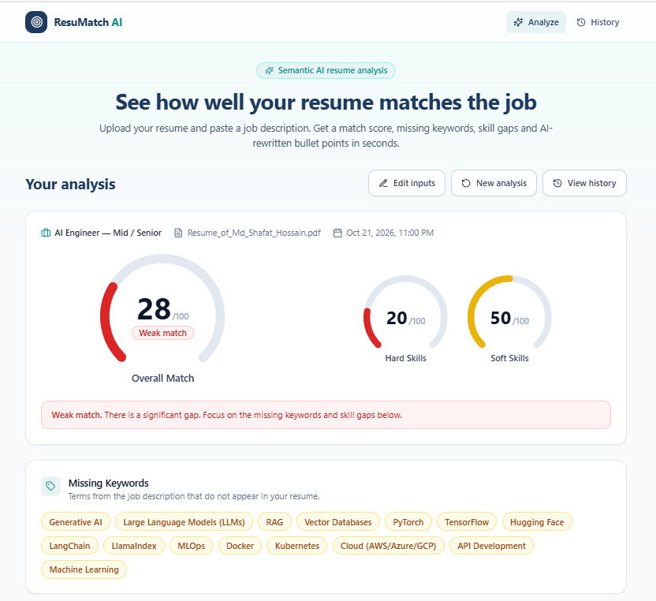
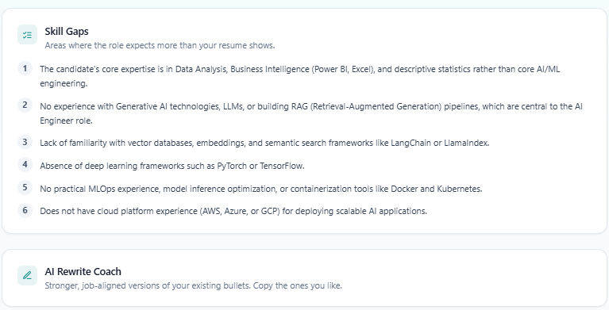
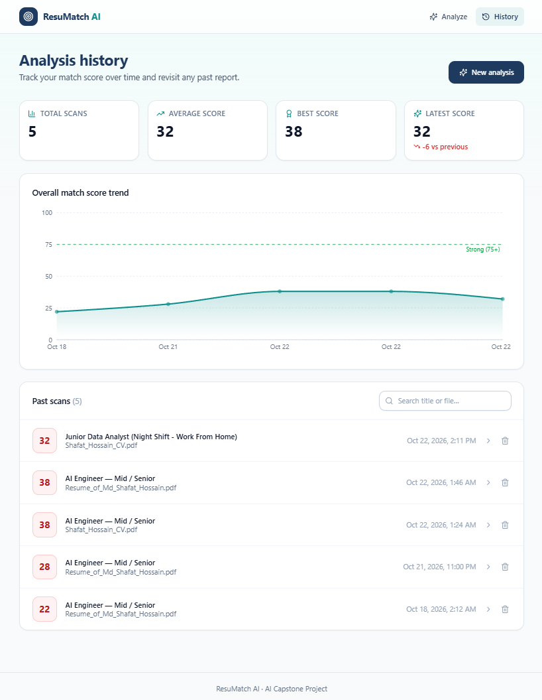
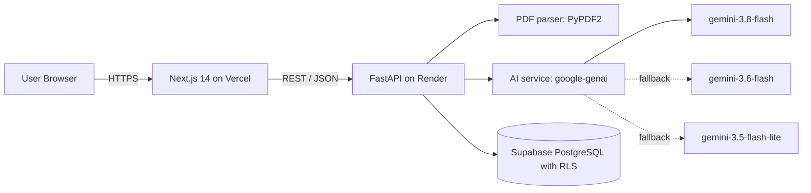

# ResuMatch AI

**Intelligent Resume-JD Gap Analysis & Career Coaching System**

Upload a PDF resume, paste a job description, and get an explainable match score, the keywords and skills you are missing, and AI-rewritten bullet points tailored to the role. Every analysis is saved so you can track your progress over time.

> AI Capstone Project (Module 27) by **Md. Shafat Hossain** · Mentor: **Sazzad**

| | Link |
|---|---|
| Live app (Vercel) | `<your-vercel-url>` |
| API (Render) | `<your-render-url>` (interactive docs at `/docs`) |
| Repository | `<your-github-repo-url>` |

---

## Table of Contents

1. [Key Features](#key-features)
2. [Screenshots](#screenshots)
3. [Architecture](#architecture)
4. [Tech Stack](#tech-stack)
5. [Project Structure](#project-structure)
6. [Environment Variables](#environment-variables)
7. [Local Development](#local-development)
8. [Database Schema and RLS](#database-schema-and-rls)
9. [API Reference](#api-reference)
10. [How the AI Works](#how-the-ai-works)
11. [Deployment](#deployment)
12. [Troubleshooting](#troubleshooting)
13. [Security Notes and Limitations](#security-notes-and-limitations)
14. [Documentation Index](#documentation-index)

---

## Key Features

- **Match scoring:** overall, hard-skills, and soft-skills scores (0-100), color-coded green (75+), yellow (50-74), red (below 50).
- **Gap analysis:** missing keywords and prioritized skill gaps relative to the job description.
- **AI Rewrite Coach:** side-by-side original vs. AI-suggested bullets with one-click copy. Unknown metrics appear as highlighted placeholders such as `[X%]` so you add real numbers instead of fabricated ones.
- **History dashboard:** score-trend area chart (Recharts), summary stats, searchable list of past scans, and a slide-over viewer for any previous report.
- **Resilient AI layer:** automatic retries with backoff and a three-model fallback chain keep the app working during rate limits and provider overload.
- **Safe by design:** strict upload validation, prompt-injection-resistant prompts, defensive JSON parsing, and Row Level Security on the database.

## Screenshots

Add your own captures to `docs/screenshots/` and keep these references:

| Analyze | Results | History |
|---|---|---|
|  |  |  |

## Architecture




**Request flow for `POST /api/analyze`:** validate the upload, extract and clean the PDF text, call the AI service (retry and fallback inside), persist the result in Supabase, and return the stored record.

## Tech Stack

| Area | Technologies |
|---|---|
| **Frontend** | Next.js 14 (App Router), React 18, TypeScript, Tailwind CSS 3, Lucide Icons, Recharts, Framer Motion, Axios |
| **Backend** | Python 3.11+, FastAPI, Uvicorn, Pydantic v2, PyPDF2, python-multipart, python-dotenv |
| **AI** | Google Gemini API through the `google-genai` SDK; models `gemini-3.8-flash`, `gemini-3.6-flash`, `gemini-3.5-flash-lite` |
| **Database** | Supabase (PostgreSQL, JSONB, Row Level Security) |
| **Hosting** | Vercel (frontend), Render (backend) |

## Project Structure

```
resumatch-ai/
├── README.md
├── docs/
│   ├── PROJECT_PROPOSAL.md
│   ├── AI_METHODOLOGY.md
│   ├── FINAL_REPORT.md
│   ├── images/architecture.png
│   └── screenshots/
├── backend/
│   ├── requirements.txt
│   ├── .env                    # not committed
│   └── app/
│       ├── main.py             # FastAPI app, CORS, routers, /health
│       ├── config.py           # environment loading and validation
│       ├── database.py         # Supabase client
│       ├── schemas.py          # Pydantic models
│       ├── routers/
│       │   ├── analyze.py      # POST /api/analyze
│       │   └── history.py      # GET /api/history, /api/history/{id}
│       └── services/
│           ├── pdf_service.py  # PDF text extraction and cleaning
│           └── ai_service.py   # Gemini prompts, fallback, parsing
└── frontend/
    ├── package.json
    ├── .env.local              # not committed
    ├── app/
    │   ├── layout.tsx
    │   ├── page.tsx            # analyze dashboard
    │   └── history/page.tsx    # history dashboard
    ├── components/             # ScoreGauge, RewriteCard, AnalysisReport, ...
    └── lib/                    # api.ts (Axios client), utils.ts
```

## Environment Variables

### Backend: `backend/.env`

```env
SUPABASE_URL=https://<project-ref>.supabase.co
SUPABASE_KEY=<service_role key, server-side only>
GEMINI_API_KEY=<your Google AI Studio API key>

# Optional overrides
GEMINI_MODEL=gemini-3.8-flash
GEMINI_FALLBACK_MODELS=gemini-3.6-flash,gemini-3.5-flash-lite
PORT=8000
```

| Variable | Required | Description |
|---|---|---|
| `SUPABASE_URL` | Yes | Project URL from Supabase, Project Settings, API. |
| `SUPABASE_KEY` | Yes | The **service_role** key. It bypasses RLS and must never be exposed to the browser. |
| `GEMINI_API_KEY` | Yes | Key from Google AI Studio. |
| `GEMINI_MODEL` | No | Primary model (default `gemini-3.8-flash`). |
| `GEMINI_FALLBACK_MODELS` | No | Comma-separated fallback chain. |

The app refuses to start if a required variable is missing.

### Frontend: `frontend/.env.local`

```env
NEXT_PUBLIC_API_URL=http://localhost:8000
```

`NEXT_PUBLIC_*` values are embedded at build time, so redeploy after changing it.

## Local Development

**Prerequisites:** Python 3.11+, Node.js 18.17+ (20 recommended), a Supabase project, and a Gemini API key.

### 1. Clone

```bash
git clone <your-github-repo-url>
cd resumatch-ai
```

### 2. Database

Open the Supabase **SQL Editor** and run the script in [Database Schema and RLS](#database-schema-and-rls).

### 3. Backend

```bash
cd backend
python -m venv venv
source venv/bin/activate          # Windows: venv\Scripts\activate
pip install -r requirements.txt
# create backend/.env as shown above
uvicorn app.main:app --reload --port 8000
```

Verify: `http://localhost:8000/health` returns `{"status":"ok"}`, and `http://localhost:8000/docs` shows the Swagger UI.

### 4. Frontend

```bash
cd frontend
npm install
cp .env.local.example .env.local   # then edit if your API URL differs
npm run dev
```

Open `http://localhost:3000`.

### 5. Try it

Upload a text-based PDF resume, paste a job description of at least 50 characters, and click **Analyze match**. Open **History** to see the saved scan and trend chart.

## Database Schema and RLS

Run once in the Supabase SQL Editor:

```sql
-- Optional: reserved for future semantic search
CREATE EXTENSION IF NOT EXISTS vector;

-- Users (reserved for upcoming authentication)
CREATE TABLE IF NOT EXISTS users (
    id UUID DEFAULT gen_random_uuid() PRIMARY KEY,
    email VARCHAR(255) UNIQUE NOT NULL,
    created_at TIMESTAMP WITH TIME ZONE DEFAULT CURRENT_TIMESTAMP
);

-- Analysis history
CREATE TABLE IF NOT EXISTS analysis_history (
    id UUID DEFAULT gen_random_uuid() PRIMARY KEY,
    user_id UUID REFERENCES users(id) ON DELETE CASCADE,   -- nullable until auth is added
    resume_filename VARCHAR(255) NOT NULL,
    job_title VARCHAR(255),
    job_description TEXT NOT NULL,
    overall_match_score INT NOT NULL CHECK (overall_match_score BETWEEN 0 AND 100),
    hard_skills_score INT CHECK (hard_skills_score BETWEEN 0 AND 100),
    soft_skills_score INT CHECK (soft_skills_score BETWEEN 0 AND 100),
    missing_keywords JSONB NOT NULL DEFAULT '[]'::jsonb,
    skill_gaps JSONB NOT NULL DEFAULT '[]'::jsonb,
    rewritten_bullets JSONB NOT NULL DEFAULT '[]'::jsonb,
    created_at TIMESTAMP WITH TIME ZONE DEFAULT CURRENT_TIMESTAMP
);

-- Indexes
CREATE INDEX IF NOT EXISTS idx_analysis_user_id ON analysis_history (user_id);
CREATE INDEX IF NOT EXISTS idx_analysis_created_at ON analysis_history (created_at DESC);

-- Row Level Security: deny by default
ALTER TABLE users ENABLE ROW LEVEL SECURITY;
ALTER TABLE analysis_history ENABLE ROW LEVEL SECURITY;

-- Defense in depth: public API roles get no direct table privileges
REVOKE ALL ON users FROM anon, authenticated;
REVOKE ALL ON analysis_history FROM anon, authenticated;
```

**How access works.** No policies are granted to `anon` or `authenticated`, so the public Supabase REST endpoint cannot read or write these tables even if the anon key leaks. The FastAPI backend connects with the `service_role` key, which bypasses RLS, so all access flows through the validated API.

**When authentication is added** (Supabase Auth), add owner-only policies, for example:

```sql
-- Example for the future (requires analysis_history.user_id to reference auth.users)
-- CREATE POLICY "Owners read own analyses" ON analysis_history
--   FOR SELECT TO authenticated USING (user_id = auth.uid());
```

The raw resume text is **not** stored; only the job description and the analysis output are persisted.

## API Reference

Base URL: `http://localhost:8000` (local) or your Render URL. Interactive docs are available at `/docs`.

### `GET /health`

Liveness check. Response: `{"status": "ok"}`.

### `POST /api/analyze`

Analyze a resume against a job description and store the result.

**Request:** `multipart/form-data`

| Field | Type | Required | Rules |
|---|---|---|---|
| `file` | file | Yes | PDF only, 5 MB maximum, must contain extractable text |
| `job_description` | string | Yes | 50 to 10,000 characters |
| `job_title` | string | No | Up to 150 characters. If omitted, derived from the first line of the JD. |

```bash
curl -X POST http://localhost:8000/api/analyze \
  -F "file=@resume.pdf;type=application/pdf" \
  -F "job_title=Data Analyst" \
  -F "job_description=Seeking a Data Analyst proficient in Python, SQL, Tableau and Machine Learning with 2+ years of experience."
```

**Response `200`:**

```json
{
  "id": "6f1c1a52-0c5e-4d0b-9a61-2c1e3b9a7e11",
  "resume_filename": "resume.pdf",
  "job_title": "Data Analyst",
  "job_description": "Seeking a Data Analyst ...",
  "created_at": "2026-10-16T18:38:54.182Z",
  "overall_match_score": 68,
  "hard_skills_score": 55,
  "soft_skills_score": 82,
  "missing_keywords": ["Tableau", "Machine Learning"],
  "skill_gaps": ["No evidence of Tableau dashboards, a core tool for this role."],
  "rewritten_bullets": [
    {
      "original": "Made reports for managers",
      "suggested": "Built Power BI reports used by managers, cutting reporting time by [X%]"
    }
  ]
}
```

**Errors**

| Status | Meaning |
|---|---|
| `400` | Empty file, or the file is not a valid PDF |
| `413` | File larger than 5 MB |
| `415` | Not a PDF (extension or content type) |
| `422` | JD length out of range, or no readable text in the PDF (for example a scanned image) |
| `502` | AI returned an invalid response after retries, or the provider rejected the request |
| `503` | AI service busy or rate limited after retries and model fallback |
| `500` | Analysis succeeded but could not be saved |

Errors use the shape `{"detail": "human-readable message"}`.

### `GET /api/history`

Recent analyses, newest first.

| Query param | Default | Rules |
|---|---|---|
| `limit` | 50 | 1 to 100 |
| `offset` | 0 | 0 or greater |

**Response `200`:** array of `{ id, resume_filename, job_title, overall_match_score, created_at }`.

### `GET /api/history/{analysis_id}`

Full stored record (same shape as the `POST /api/analyze` response). `analysis_id` must be a UUID.

| Status | Meaning |
|---|---|
| `200` | Record found |
| `404` | No analysis with that ID |
| `422` | `analysis_id` is not a valid UUID |
| `500` | Database error |

## How the AI Works

A single structured call to Google Gemini compares the resume and JD using a rubric (overall is roughly 60% hard skills, 25% experience relevance, 15% soft skills). The resume and JD are isolated inside `<resume>` and `<job_description>` tags to resist prompt injection. The output is forced into JSON, then parsed defensively, normalized (scores clamped to 0-100, lists de-duplicated and capped), and validated with Pydantic. On rate limits or overload, the service retries with backoff and rotates through `gemini-3.8-flash`, `gemini-3.6-flash`, and `gemini-3.5-flash-lite`.

Full details: [docs/AI_METHODOLOGY.md](docs/AI_METHODOLOGY.md).

## Deployment

### Backend on Render

1. Push the repository to GitHub.
2. In Render: **New, Web Service**, connect the repository.
3. Settings:

| Setting | Value |
|---|---|
| Root Directory | `backend` |
| Runtime | Python 3 |
| Build Command | `pip install -r requirements.txt` |
| Start Command | `uvicorn app.main:app --host 0.0.0.0 --port $PORT` |
| Health Check Path | `/health` |

4. Add environment variables: `SUPABASE_URL`, `SUPABASE_KEY` (service_role), `GEMINI_API_KEY`, and optionally `GEMINI_MODEL` and `GEMINI_FALLBACK_MODELS`.
5. Deploy and note the service URL.

> Free-tier services sleep after inactivity, so the first request can take up to a minute. The frontend uses a 120-second timeout and a progress screen to handle this.

### Frontend on Vercel

1. In Vercel: **Add New, Project**, import the same repository.
2. Set **Root Directory** to `frontend` (framework preset: Next.js).
3. Add the environment variable `NEXT_PUBLIC_API_URL` set to your Render URL (no trailing slash).
4. Deploy. If you change the variable later, trigger a redeploy.

### Post-deployment checklist

- [ ] `<render-url>/health` returns `{"status":"ok"}`.
- [ ] An analysis from the Vercel site returns results and appears under **History**.
- [ ] Tighten CORS in `backend/app/main.py` by replacing `allow_origins=["*"]` with your Vercel domain.
- [ ] Confirm RLS is enabled on both tables and the backend uses the `service_role` key.

## Troubleshooting

| Symptom | Likely cause and fix |
|---|---|
| `503 The AI service is busy` | Gemini overloaded or rate limited. The backend already retries across three models. Wait a minute and retry. Check server logs for the exact `Gemini error <code>` line. |
| `422 No readable text found` | The PDF is a scan or image. Export a text-based PDF from your editor. |
| `Cannot reach the server` in the UI | Backend not running or `NEXT_PUBLIC_API_URL` is wrong. Redeploy the frontend after fixing it. |
| Insert fails with a permission error | `SUPABASE_KEY` is the anon key. Use the `service_role` key now that RLS is enabled. |
| App exits at startup with `Missing required environment variable` | Add the named variable to `.env` or the hosting dashboard. |

## Security Notes and Limitations

- Upload validation checks extension, content type, size, and the PDF magic bytes.
- The `service_role` key lives only on the backend. `.env` files are git-ignored.
- Prompt-injection defenses reduce, but cannot fully eliminate, risk from adversarial resume or JD text.
- **Current limitation:** there is no user authentication yet, so history is shared across all users of a deployment. Do not use the public instance for sensitive resumes. Per-user history is the first planned enhancement.
- There is no inbound rate limiting on the API yet (only upstream retry handling).
- CORS is open (`*`) by default for development. Restrict it in production.

## Documentation Index

| Document | Purpose |
|---|---|
| [docs/PROJECT_PROPOSAL.md](docs/PROJECT_PROPOSAL.md) | Problem, solution, architecture rationale |
| [docs/AI_METHODOLOGY.md](docs/AI_METHODOLOGY.md) | AI model integration, prompts, fallback, resilience |
| [docs/FINAL_REPORT.md](docs/FINAL_REPORT.md) | Complete technical report and lessons learned |

---

Built by **Md. Shafat Hossain**.
