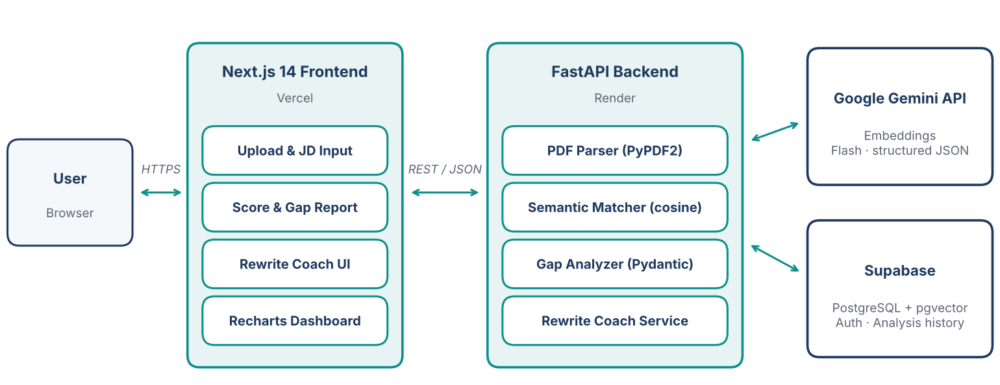

# ResuMatch AI: Project Proposal

**Intelligent Resume-JD Gap Analysis & Career Coaching System**

| | |
|---|---|
| **Student** | Md. Shafat Hossain |
| **Mentor** | Sazzad Hossain |
| **Live app** | https://resumatch-ai-five.vercel.app/ |
| **Backend API** | https://resumatch-ai-rizc.onrender.com (interactive docs at `/docs`) |
| **Repository** | https://github.com/mdshafathossain-tech/resumatch-ai |
| **Course component** | Module 27: AI Capstone Project |
| **Date** | October 2026 |

---

## 1. Executive Summary

ResuMatch AI is a full-stack web application that tells a job seeker, within seconds, how well their resume fits a specific job description (JD), exactly what is missing, and how to fix it. The user uploads a PDF resume and pastes a JD. The system returns an explainable match score (overall, hard skills, soft skills), the keywords and skills the resume lacks, and AI-rewritten bullet points that are aligned to the role without inventing experience. Every analysis is stored, so users can track their progress over time on a history dashboard.

The system combines a **Next.js 14** frontend, a **FastAPI** backend, **Supabase (PostgreSQL)** for persistence, and the **Google Gemini API** (`google-genai` SDK) for analysis.

## 2. Real-World Problem Statement

Most mid-size and large employers screen applications through Applicant Tracking Systems (ATS) before a human sees them. This creates three connected problems for candidates:

1. **Opaque filtering.** ATS pipelines rely heavily on keyword matching. A qualified candidate can be filtered out because the resume says "dashboarding" where the JD says "data visualization", and the candidate never learns why.
2. **Resume-JD mismatch.** Candidates, especially fresh graduates and career switchers, send one generic resume to many roles. They rarely know which required skills their resume under-represents or omits.
3. **No actionable feedback.** Existing tools are either generic checklists or paid services. They do not rewrite a specific bullet point for a specific role, and they do not let the candidate see whether their changes improved the match.

The result is wasted applications, lower confidence, and an advantage for candidates who can afford professional resume coaching.

## 3. Proposed Solution and Objectives

**Objectives**

| # | Objective |
|---|---|
| O1 | Accept a PDF resume and a JD and return a calibrated 0-100 match score with hard-skill and soft-skill sub-scores. |
| O2 | Identify missing keywords and prioritized skill gaps relative to the JD. |
| O3 | Generate role-aligned bullet rewrites that never fabricate facts and flag where a real metric should be added (`[X%]`). |
| O4 | Persist every analysis, visualize score trends over time, and let users delete saved analyses (full create, read, delete on the history dashboard). |
| O5 | Remain reliable under free-tier AI quotas through retries and automatic model fallback. |
| O6 | Be deployed publicly (Vercel + Render) with documentation and a clean repository. |

**In scope:** PDF (text-based) resumes up to 5 MB, English-language JDs, analysis, rewrite suggestions, history and trend dashboard, public deployment.

**Out of scope (future work):** user authentication and per-user history, scanned-PDF OCR, multi-language support, job-board integrations.

## 4. System Architecture and Technology Rationale

| Layer | Choice | Why this choice |
|---|---|---|
| Frontend | Next.js 14 (App Router), TypeScript, Tailwind CSS, Lucide, Recharts, Framer Motion | File-based routing, type safety, rapid responsive styling, and declarative charts for the trend dashboard. |
| Backend | FastAPI + Uvicorn, Pydantic, PyPDF2 | Async-capable REST framework with automatic OpenAPI docs and strict request/response validation. |
| AI | Google Gemini API via `google-genai` SDK | Generous free tier, native JSON output mode, strong long-context reasoning for resume/JD comparison. |
| Database | Supabase (PostgreSQL) with Row Level Security | Managed Postgres, JSONB for flexible analysis payloads, built-in security model. |
| Hosting | Vercel (frontend), Render (backend) | Free tiers, Git-based deploys, and a clean separation of static/edge delivery from the API. |

## 5. AI Approach

The core analysis is a **single structured LLM call** per request, designed for explainability and reliability:

- **Rubric-driven scoring.** A system instruction defines how hard skills, soft skills, and overall fit are scored (overall is roughly 60% hard skills, 25% experience relevance, 15% soft skills) and tells the model to stay calibrated and never inflate scores.
- **Prompt-injection resistance.** The resume and JD are wrapped in `<resume>` and `<job_description>` XML tags, treated strictly as data, and any user-supplied copies of these tags are stripped.
- **Strict structured output.** The model is forced into JSON mode with a fixed schema. The response is then parsed defensively, normalized, and validated with Pydantic.
- **Resilience.** Transient failures (HTTP 429/500/503/504) trigger bounded retries with backoff while rotating through a model chain: `gemini-3.8-flash`, then `gemini-3.6-flash`, then `gemini-3.5-flash-lite`.
- **Honest rewrites.** Suggestions must be grounded in bullets that actually exist in the resume, and unknown metrics are left as visible placeholders such as `[X%]` so users add real numbers.

## 6. Expected Impact and Success Criteria

- **Users:** candidates get ATS-style insight and coaching that is normally paywalled, and can measure improvement across resume versions.
- **Measurable targets:** end-to-end analysis in roughly 10-20 seconds for a typical two-page resume; at least 95% of model responses passing schema validation after retries; zero unhandled server errors on malformed input (wrong file type, empty file, scanned PDF).
- **Learning outcomes:** end-to-end delivery of a production-style AI product covering frontend, backend, database security, LLM engineering, and deployment.
